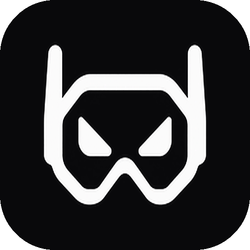

<h1 align="center"> Raze</h1>

  A Windows auto-typer. 
  Put your messages in, press a key, and it types them for you.

  
  

## Download

[Raze.exe](https://github.com/nawaf49/Raze/releases/latest) — grab it and run it.
Run it once and Raze installs itself: a shortcut appears in your Start Menu,
and it shows up in Settings, where the Uninstall button removes it. There is
nothing to click.

## Keys

| Key | Command |
| --- | --- |
| `F8` | Start |
| `F6` | Pause |
| `F7` | Resume |
| `F9` | Stop |

Tab over to your app first, then press `F8`. Raze won't start while its own
window is in front, and it stops itself if you tab back in. When that
happens, `F7` continues that same run and `F8` starts a new one.

## What it does

Raze takes a list of your messages and types them into whatever app is open,
one at a time, pressing Enter after each one.

- On first run Raze installs itself — a Start Menu shortcut and an
  entry in Settings with a working Uninstall button. Your messages and
  history stay in your own folder.
- Put your messages in the box, one per line. Load them from a `.txt` file,
  save them back, shuffle them, or clear them.
- Choose how many seconds pass between messages, and how many times Raze
  goes through the list. `0` means keep going until you stop it.
- Turn on random order to send them shuffled instead of top to bottom.
- Each of the four keys can be changed on the Hotkeys tab.
- Pause keeps your counters and stops the clock. `F7` picks up where you
  left off, and `F9` ends the session.
- Counters never get cut off. When a number is too long for its box, Raze
  draws it smaller instead of shortening it, so nothing ever ends in `...`
  however long Raze runs.
- Raze never types into itself. If it's the window in front it won't start,
  and it stops if you click back into it.
- The History tab shows how many messages you sent each day, plus a total
  for all time.
- The top bar shows how long Raze has been open. It keeps counting through
  pauses and stops, and only starts over when you close Raze.
- If Raze stops without you asking — the list ran out, typing failed, or you
  clicked back into Raze — you get a Windows notification. Not when you stop
  it yourself.

## Screen sizes

Raze fits itself to your screen: it shrinks or grows the whole window to
match what your display can show, so nothing gets cut off at the edges. It
works on screens from 800x600 up to 4K, at 100%, 125% and 150% Windows
scaling. Anything smaller than 800x600 may not fit.

## Your data

Everything is saved on your own computer, in `%APPDATA%\Raze` — a folder in
your user account, not next to the program. You can delete `Raze.exe` and
nothing is lost.
