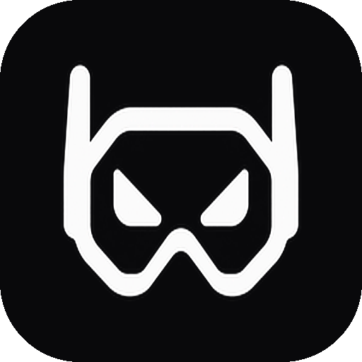

<h1 align="center"> Raze</h1>

<p align="center">
  A Windows auto-typer.<br>
  Put your messages in, press a key, and it types them for you.
</p>

<p align="center">
  <a href="https://github.com/nawaf49/Raze/releases/latest"></a>
  
</p>

## Download

[Raze.exe](https://github.com/nawaf49/Raze/releases/latest) - grab it and run it.
Run it once and Raze installs itself: a shortcut appears in your Start Menu,
and it shows up in Settings, where the Uninstall button removes it. There is
nothing to click.

## Keys

| Key | Command |
| --- | --- |
| `F8` | Start |
| `F6` | Pause |
| `F7` | Resume |
| `F9` | Stop |

Tab over to your app first, then press `F8`. Raze won't start while its own
window is in front, and it stops itself if you tab back in. When that
happens, `F7` continues that same run and `F8` starts a new one.

## What it does

Raze takes a list of your messages and types them into whatever app is open,
one at a time, pressing Enter after each one.

- On first run Raze installs itself - a Start Menu shortcut and an
  entry in Settings with a working Uninstall button. Your messages and
  history stay in your own folder.
- Put your messages in the box, one per line. Load them from a `.txt` file,
  save them back, shuffle them, or clear them.
- Raze keeps several lists of messages at once. Switch between them, add a new
  one, give it your own name, or delete one from the row under the box -
  Raze remembers every list.
- Choose how many seconds pass between messages, and how many times Raze
  goes through the list. `0` means keep going until you stop it.
- Turn on random order to send them shuffled instead of top to bottom.
- Each of the four keys can be changed on the Hotkeys tab.
- Pause keeps your counters and stops the clock. `F7` picks up where you
  left off, and `F9` ends the session.
- Counters never get cut off. When a number is too long for its box, Raze
  draws it smaller instead of shortening it, so nothing ever ends in `...`
  however long Raze runs.
- Raze never types into itself. If it's the window in front it won't start,
  and it stops if you click back into it.
- The History tab shows how many messages you sent each day, plus a total
  for all time, and the date each record was set.
- The Updates tab lists what each version of Raze changed. Raze updates
  itself in the background, so this is where you find out what's new.
- The top bar shows how long Raze has been open. It keeps counting through
  pauses and stops, and only starts over when you close Raze.
- If Raze stops without you asking - the list ran out, typing failed, or you
  clicked back into Raze - you get a Windows notification. Not when you stop
  it yourself.

## Screen sizes

Raze fits itself to your screen: it shrinks or grows the whole window to
match what your display can show, so nothing gets cut off at the edges. It
works on screens from 800x600 up to 4K, at 100%, 125% and 150% Windows
scaling. Anything smaller than 800x600 may not fit.

## Your data

Everything is saved on your own computer, in `%APPDATA%\Raze` - a folder in
your user account, not next to the program. You can delete `Raze.exe` and
nothing is lost.

Your messages and settings are saved as you change them, so nothing is lost
even if Raze closes unexpectedly.

## Build from source

```powershell
python build_assets.py
pyinstaller --onefile --windowed --icon="assets\raze.ico" --version-file "version_info.txt" --add-data "assets;assets" --additional-hooks-dir "hooks" --exclude-module numpy --exclude-module typing_extensions --exclude-module PyQt5 --exclude-module PyQt6 --exclude-module PySide2 --exclude-module PySide6 --name "Raze" AutoTyper.py
```

`--additional-hooks-dir "hooks"` is not optional. `hooks/hook-PIL.Image.py`
replaces Pillow's own hook, which collects **every** image codec Pillow ships -
including a 7.7 MB AVIF library. Raze only ever opens one PNG, and a onefile
build unpacks the entire payload to a temporary folder on every single launch,
so that hook is most of what makes Raze open quickly.

`--exclude-module numpy` matters for the same reason, and it is a trap that only
springs once numpy happens to be installed. Pillow names numpy inside a couple of
docstrings and inside one `try: import numpy / except ImportError:` block, and
PyInstaller's modulegraph collects it as a real dependency. Raze never builds an
image from an array, so the import always fails at runtime and is always caught -
but if numpy *is* on the machine it gets bundled anyway, and it drags a 20.6 MB
OpenBLAS library with it. Excluding it keeps the payload the same size on every
machine regardless of what else is installed.

The Qt excludes (`PyQt5`, `PyQt6`, `PySide2`, `PySide6`) and
`--exclude-module typing_extensions` guard the same boundary. Pillow's `ImageQt`
and the clipboard library `pyperclip` both probe for a Qt binding inside
`try:`/`except ImportError:` blocks - imports that fail harmlessly on a machine
without Qt, but that PyInstaller follows as if they were real. One is enough:
a stray `pip install` put PyQt5 on a build machine and the executable grew from
15 MB to 45.6 MB of DLLs, plugins and translations for code Raze never runs
(it draws with Tk). `typing_extensions` is the same story one layer deeper -
`customtkinter` only names it in Python-3.7-era fallbacks - except that it
imports `asyncio`, which drags `multiprocessing`, `hmac` and `runpy` in behind
it, about 700 KB all told. None of these modules is ever imported at runtime;
excluding them costs nothing and pins the payload.

`python make_shortcut.py` then drops a Start Menu and Desktop shortcut - a
dev convenience (pywin32, not installed on every machine). The
shipped exe does the same job itself, from inside `AutoTyper.py`; see the
Install section of `AGENTS.md`.

```powershell
python selftest.py      # or: Raze.exe --selftest
```

runs the headless checks (hotkeys, text rendering, history, config) without
opening a window.

## Credits

Typeface: [Geist](https://github.com/vercel/geist-font) by Vercel, in
collaboration with basement.studio (SIL Open Font License).
